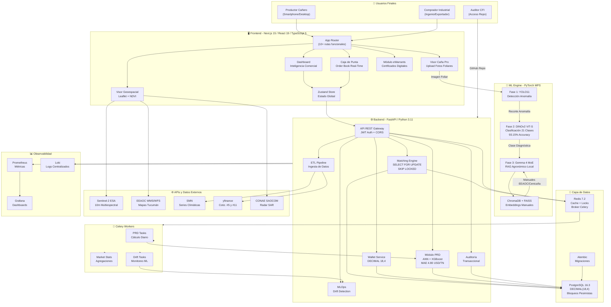

# AGRO-IA SAS
# DOCUMENTACIÓN TÉCNICA ADICIONAL PARA PROYECTOS DIGITALES
## Punto 18 — Acceso a Repositorio de Código, SBOM y Arquitectura del Sistema

**Entidad Postulante:** Agro-IA SAS — CUIT 30-71931274-4
**Referencia de Convocatoria:** Punto 18: Documentación Técnica Adicional — Fondo de Inversión en Innovación (CFI)
**Responsables Técnicos:** Lic. Arquímedes Ramón Carrizo (CEO) | Ing. Adolfo Andrés Rodríguez Robles Terán (COO)
**Fecha y Lugar:** San Miguel de Tucumán, Noviembre 2026

---

## 18.1 Acceso al Repositorio de Código Fuente

### Repositorio Principal Unificado (Monorepo)

| Campo | Detalle |
|---|---|
| **URL del Repositorio** | `https://github.com/19822731/AGRO-IA-CFI` |
| **Tipo de Repositorio** | Monorepo unificado (Backend + Frontend + ML Engine) |
| **Sistema de Control de Versiones** | Git (GitHub) |
| **Visibilidad** | Privado (acceso disponible bajo solicitud formal al equipo de Agro-IA SAS para auditores designados por el CFI) |
| **Rama Principal** | `main` (producción estable) |
| **Total de Commits** | 7+ commits de integración y desarrollo |
| **Último Commit** | `fix(agents): implementa auto-selección dinámica del modelo Gemini activo` |

### Estructura del Monorepo

```
AGRO-IA-CFI/
├── backend/                          # Backend Transaccional (Python/FastAPI)
│   ├── app/                          # Código fuente del servidor
│   │   ├── routes/                   # Endpoints REST API (mercado, billetera, PRD, usuarios, auditoría)
│   │   ├── services/                 # Servicios de negocio (wallet_service)
│   │   ├── prd/                      # Módulo PRD (Precio de Referencia Dinámico)
│   │   ├── mlops/                    # Monitoreo de drift y MLOps
│   │   ├── etl/                      # Pipeline de ingesta de datos
│   │   ├── audit/                    # Sistema de auditoría transaccional
│   │   └── utils/                    # Utilidades (db_retry, etc.)
│   ├── alembic/                      # Migraciones de base de datos
│   ├── Algoritmo v.2/               # Motor predictivo ANN + XGBoost (series temporales)
│   ├── tests/                        # Suite de pruebas automatizadas
│   ├── Dockerfile                    # Imagen de contenedor del backend
│   └── requirements.txt              # Dependencias Python
│
├── frontend/                         # Frontend Operacional (Next.js/React)
│   ├── sugartrade_contents/          # Aplicación web principal
│   │   ├── app/                      # Rutas Next.js App Router (10+ rutas funcionales)
│   │   │   ├── dashboard/            # Dashboard principal de inteligencia comercial
│   │   │   ├── operar/               # Caja de Punta y Order Book en tiempo real
│   │   │   ├── portafolio/           # Gestión de portafolio del productor
│   │   │   ├── warrants/             # Módulo de eWarrants digitales
│   │   │   ├── evolucion-precio/     # Gráficos de evolución de precios
│   │   │   ├── mundo-campo/          # Visor geoespacial y satelital
│   │   │   └── login/               # Autenticación de usuarios
│   │   ├── components/               # Componentes UI reutilizables (29+)
│   │   ├── hooks/                    # Custom React Hooks (21 hooks)
│   │   ├── lib/                      # Servicios, autenticación, cache, logging
│   │   ├── store/                    # Estado global (Zustand)
│   │   └── data/                     # Datos de mercado estáticos
│   ├── tests/                        # Pruebas del backend API
│   ├── tests_perf/                   # Pruebas de carga con Locust
│   └── requirements.txt              # Dependencias Python del API
│
├── ml_engine/                        # Motor de Visión Computacional (PyTorch)
│   ├── train_dinov2.py               # Entrenamiento DINOv2 ViT-Small (Linear Probe)
│   ├── train_efficientnet.py         # Benchmark EfficientNet-B0
│   ├── train_swin_v2.py             # Benchmark Swin-V2 Tiny/Small
│   ├── pangea_inference_bridge.py    # Pipeline de inferencia YOLO11 + DINOv2 + LLM
│   ├── pangea_bridge_gemma4.py       # Integración con Gemma 4 MoE (RAG agronómico)
│   ├── visor_cana_pangea.py          # Aplicación Visor Caña Pro
│   ├── app_visor_cana.py             # Interfaz web del visor
│   ├── preparar_master_dataset.py    # Curación del Master Dataset (47.628 imágenes)
│   ├── competencia_modelos.py        # Torneo de modelos de visión
│   ├── auditoria_dino.py             # Auditoría de calidad del clasificador
│   └── MASTER_DATASET_LOG.md         # Trazabilidad del dataset
│
├── agents_cfi_loop/                  # Motor multi-agente para documentación CFI
│   └── main.py                       # Bucle de agentes con Gemini API
│
├── CFI_AUDIT_LOG.md                  # Log de auditoría para el CFI
└── .gitignore                        # Exclusiones del repositorio
```

### Repositorios Complementarios (Históricos)

| Repositorio | URL | Función |
|---|---|---|
| AGRO-IA (histórico) | `github.com/19822731/AGRO-IA` | Repositorio original del Marketplace y algoritmos PRD |
| marketplace-agro-ia | `github.com/19822731/marketplace-agro-ia` | Versión anterior del marketplace transaccional |
| agro-ia-cv-model | `github.com/19822731/agro-ia-cv-model` | Repositorio del modelo de visión computacional |

> **Nota:** Todo el código relevante ha sido consolidado en el monorepo principal `AGRO-IA-CFI` para facilitar la auditoría integral del proyecto.

---

## 18.2 Lista de Materiales de Software (SBOM — Software Bill of Materials)

### 18.2.1 Módulo Backend — Servidor Transaccional y API REST (Python)

| Componente | Versión | Licencia | Enlace Web | Funcionalidad en Agro-IA |
|---|---|---|---|---|
| **Python** | 3.11.9 | PSF License | https://python.org | Runtime principal del backend y ML Engine |
| **FastAPI** | 0.116.1 | MIT | https://fastapi.tiangolo.com | Framework web asíncrono para la API REST transaccional |
| **Uvicorn** | 0.35.0 | BSD-3-Clause | https://www.uvicorn.org | Servidor ASGI de alto rendimiento para FastAPI |
| **SQLAlchemy** | 2.0.41 | MIT | https://sqlalchemy.org | ORM para mapeo relacional con PostgreSQL (modelos de órdenes, billeteras, warrants) |
| **Alembic** | 1.16.4 | MIT | https://alembic.sqlalchemy.org | Migraciones de esquema de base de datos con trazabilidad de versiones |
| **Pydantic** | 2.11.7 | MIT | https://pydantic.dev | Validación y serialización de datos en endpoints API y configuración |
| **Celery** | 5.5.3 | BSD-3-Clause | https://docs.celeryq.dev | Cola de tareas asíncronas (cálculo PRD, ETL, drift detection, auditoría) |
| **Redis** | ≥5.0 (cliente) | MIT | https://redis.io | Cache en memoria, broker de Celery y locks distribuidos para concurrencia |
| **Psycopg2-binary** | latest | LGPL-3.0 | https://psycopg.org | Driver PostgreSQL nativo para conexiones de alta concurrencia |
| **python-jose** | 3.5.0 | MIT | https://github.com/mpdavis/python-jose | Generación y validación de tokens JWT para autenticación de usuarios |
| **Passlib** | 1.7.4 | BSD-3-Clause | https://passlib.readthedocs.io | Hashing seguro de contraseñas (bcrypt) |
| **yfinance** | 0.2.65 | Apache-2.0 | https://github.com/ranaroussi/yfinance | Ingesta de cotizaciones azúcar Contrato #5 Londres, #11 NY y tipos de cambio |
| **XGBoost** | latest | Apache-2.0 | https://xgboost.readthedocs.io | Componente del ensamble híbrido ANN+XGBoost para predicción PRD |
| **scikit-learn** | latest | BSD-3-Clause | https://scikit-learn.org | Preprocesamiento, métricas de evaluación y modelos base de referencia |
| **statsmodels** | latest | BSD-3-Clause | https://statsmodels.org | Análisis estadístico de series temporales y modelos ARIMA/SARIMAX |
| **Prophet** | latest | MIT | https://facebook.github.io/prophet | Modelo benchmark de series temporales para comparativa con PRD |
| **Prometheus Client** | latest | Apache-2.0 | https://github.com/prometheus/client_python | Exportación de métricas de telemetría del backend |
| **prometheus-fastapi-instrumentator** | latest | ISC | https://github.com/trallnag/prometheus-fastapi-instrumentator | Instrumentación automática de endpoints FastAPI |
| **asgi-correlation-id** | 4.3.4 | MIT | https://github.com/snok/asgi-correlation-id | Trazabilidad de requests con IDs de correlación |
| **python-json-logger** | latest | BSD-2-Clause | https://github.com/madzak/python-json-logger | Logging estructurado en formato JSON para observabilidad |
| **httpx** | latest | BSD-3-Clause | https://www.python-httpx.org | Cliente HTTP asíncrono para consumo de APIs externas |
| **holidays** | 0.76 | MIT | https://github.com/vacanza/python-holidays | Calendarios de feriados para cálculo de días hábiles del PRD |
| **pytest** | latest | MIT | https://pytest.org | Framework de testing automatizado (suite de pruebas unitarias e integración) |
| **pydantic-settings** | latest | MIT | https://docs.pydantic.dev/latest/concepts/pydantic_settings | Gestión de configuración por variables de entorno (.env) |

### 18.2.2 Módulo Frontend — Plataforma Web Operacional (Node.js / TypeScript)

| Componente | Versión | Licencia | Enlace Web | Funcionalidad en Agro-IA |
|---|---|---|---|---|
| **Next.js** | 15.2.4 | MIT | https://nextjs.org | Framework fullstack React con SSR, App Router y API routes |
| **React** | 19 | MIT | https://react.dev | Biblioteca de UI para la interfaz del Marketplace y Dashboard |
| **React DOM** | 19 | MIT | https://react.dev | Renderizado del árbol de componentes en el navegador |
| **TypeScript** | 5.x | Apache-2.0 | https://typescriptlang.org | Tipado estático para seguridad de tipos en todo el frontend |
| **Tailwind CSS** | 3.4.17 | MIT | https://tailwindcss.com | Framework de utilidades CSS para diseño responsive |
| **Zustand** | latest | MIT | https://zustand-demo.pmnd.rs | Gestión de estado global (orden book, warrants, precios en tiempo real) |
| **Recharts** | latest | MIT | https://recharts.org | Gráficos financieros interactivos (evolución de precios, volúmenes) |
| **Chart.js** | latest | MIT | https://chartjs.org | Gráficos complementarios de datos de mercado |
| **react-chartjs-2** | latest | MIT | https://react-chartjs-2.js.org | Wrapper React para Chart.js |
| **Leaflet** | latest | BSD-2-Clause | https://leafletjs.com | Motor cartográfico para mapas geoespaciales (parcelas, NDVI) |
| **react-leaflet** | latest | Hippocratic-2.1 | https://react-leaflet.js.org | Integración de Leaflet con componentes React |
| **Framer Motion** | latest | MIT | https://motion.dev | Animaciones y transiciones de UI |
| **@radix-ui/react-\*** | latest | MIT | https://radix-ui.com | Componentes UI accesibles y sin estilos (dialog, tabs, select, etc.) |
| **Lucide React** | 0.454.0 | ISC | https://lucide.dev | Biblioteca de íconos SVG |
| **react-hook-form** | latest | MIT | https://react-hook-form.com | Gestión de formularios (ingreso de órdenes, registro) |
| **Zod** | 3.24.1 | MIT | https://zod.dev | Validación de esquemas en formularios y API responses |
| **date-fns** | latest | MIT | https://date-fns.org | Manipulación de fechas (series temporales, vencimientos warrant) |
| **PapaParse** | latest | MIT | https://papaparse.com | Parsing de archivos CSV de datos de mercado |
| **jose** | latest | MIT | https://github.com/panva/jose | Verificación de JWT en el frontend |
| **clsx** | 2.1.1 | MIT | https://github.com/lukeed/clsx | Utilidad para clases CSS condicionales |
| **tailwind-merge** | 2.5.5 | MIT | https://github.com/dcastil/tailwind-merge | Merge inteligente de clases Tailwind |
| **Sonner** | latest | MIT | https://sonner.emilkowal.ski | Notificaciones toast para feedback de operaciones |
| **cmdk** | latest | MIT | https://cmdk.paco.me | Paleta de comandos (búsqueda rápida) |
| **PostCSS** | 8.5 | MIT | https://postcss.org | Procesamiento CSS para Tailwind |

### 18.2.3 Módulo ML Engine — Motor de Visión Computacional e IA (Python / PyTorch)

| Componente | Versión | Licencia | Enlace Web | Funcionalidad en Agro-IA |
|---|---|---|---|---|
| **PyTorch** | 2.7.1 (MPS build) | BSD-3-Clause | https://pytorch.org | Framework de deep learning para entrenamiento e inferencia del clasificador |
| **TorchVision** | 0.22.1 | BSD-3-Clause | https://pytorch.org/vision | Transformaciones de imágenes, augmentación de datos y modelos preentrenados |
| **DINOv2 ViT-Small** | facebook/dinov2-small | Apache-2.0 | https://github.com/facebookresearch/dinov2 | Backbone de representaciones visuales (21M params, 93,15% accuracy) |
| **Ultralytics YOLO11** | latest | **AGPL-3.0** ¹ | https://docs.ultralytics.com | Detección y recorte de anomalías foliares (Fase 1 del pipeline) |
| **Gemma 4 26B MoE** | google/gemma-4 | **Gemma Terms of Use** ² | https://ai.google.dev/gemma | LLM local para diagnóstico RAG agronómico (Fase 3 del pipeline) |
| **Transformers** (HuggingFace) | dev branch | Apache-2.0 | https://huggingface.co/transformers | Carga e inferencia de modelos preentrenados (DINOv2, Gemma) |
| **Accelerate** | 1.8.1 | Apache-2.0 | https://huggingface.co/accelerate | Aceleración de entrenamiento e inferencia distribuida |
| **MLX** | 0.18.0 | MIT | https://github.com/ml-explore/mlx | Framework de ML optimizado para Apple Silicon (Neural Engine) |
| **ChromaDB** | 1.0.15 | Apache-2.0 | https://www.trychroma.com | Base de datos vectorial para RAG (embeddings de manuales EEAOC/Cenicaña) |
| **FAISS** | 1.10.0 | MIT | https://github.com/facebookresearch/faiss | Búsqueda de similitud vectorial de alta performance |
| **Datasets** (HuggingFace) | latest | Apache-2.0 | https://huggingface.co/docs/datasets | Carga y procesamiento del Master Dataset (47.628 imágenes) |
| **XGBoost** | latest | Apache-2.0 | https://xgboost.readthedocs.io | Regresor del ensamble PRD (compartido con backend) |
| **ARCH** | 7.2.0 | NCSA | https://arch.readthedocs.io | Modelos de volatilidad condicional (GARCH) para series de precios |
| **DuckDB** | 1.3.2 | MIT | https://duckdb.org | Motor analítico SQL embebido para procesamiento de datasets masivos |

> **¹ Nota sobre AGPL-3.0 (YOLO11):** La licencia AGPL-3.0 de Ultralytics requiere que cualquier software que incorpore YOLO11 y se distribuya como servicio de red publique su código fuente bajo la misma licencia, o bien adquiera una licencia comercial de Ultralytics. Agro-IA SAS evaluará la adquisición de licencia comercial para la etapa de producción (Hito 2).

> **² Nota sobre Gemma Terms of Use:** Gemma 4 opera bajo los términos de uso de Google DeepMind que permiten inferencia comercial local on-premise, garantizando privacidad absoluta de los datos agrícolas sin envío de información a servidores externos.

### 18.2.4 Infraestructura, DevOps y Servicios de Plataforma

| Componente | Versión | Licencia | Enlace Web | Funcionalidad en Agro-IA |
|---|---|---|---|---|
| **PostgreSQL** | 16.3 | PostgreSQL License (permisiva) | https://postgresql.org | Base de datos transaccional ACID con precisión DECIMAL(18,4) |
| **Redis** | 7.2 | BSD-3-Clause | https://redis.io | Cache de alta velocidad, broker de Celery y locks distribuidos |
| **Docker** | latest | Apache-2.0 | https://docker.com | Contenerización de servicios (backend, Redis, PostgreSQL) |
| **Docker Compose** | 2.27 | Apache-2.0 | https://docs.docker.com/compose | Orquestación local de la pila de servicios |
| **Prometheus** | latest | Apache-2.0 | https://prometheus.io | Recolección de métricas de rendimiento del sistema |
| **Grafana** | latest | AGPL-3.0 | https://grafana.com | Dashboards de observabilidad y alertas operacionales |
| **Loki** | latest | AGPL-3.0 | https://grafana.com/oss/loki | Agregación centralizada de logs del sistema |
| **Locust** | 2.29.1 | MIT | https://locust.io | Framework de pruebas de carga y estrés transaccional |

### 18.2.5 APIs Externas e Integraciones de Datos

| Servicio / API | Proveedor | Tipo de Acceso | Enlace Web | Funcionalidad en Agro-IA |
|---|---|---|---|---|
| **WMS/WFS Mapas Satelitales** | EEAOC / Gob. de Tucumán | Público (servicios OGC abiertos) | https://gis.producciontucuman.gob.ar | Capas geoespaciales de parcelas cañeras y mapas de producción |
| **Sentinel-2 (ESA)** | Agencia Espacial Europea | Público y gratuito | https://scihub.copernicus.eu | Imágenes multiespectrales 10m para cálculo de NDVI y monitoreo satelital |
| **SAOCOM / SAR** | CONAE (Argentina) | Institucional | https://www.argentina.gob.ar/conae | Radar de apertura sintética para humedad de suelo y detección de cultivos |
| **Servicio Meteorológico Nacional** | SMN (Argentina) | Público | https://www.smn.gob.ar | Series climáticas históricas (precipitaciones, temperaturas, anomalías) |
| **Capas Agronómicas** | INTA (Argentina) | Público | https://www.argentina.gob.ar/inta | Datos agronómicos de suelos, cultivos y productividad regional |
| **Cotizaciones Azúcar** | Yahoo Finance (yfinance) | Público (API gratuita) | https://finance.yahoo.com | Precios internacionales Contrato #5 Londres y #11 Nueva York, FX rates |
| **Landsat 8** | USGS / NASA | Público y gratuito | https://landsat.gsfc.nasa.gov | Imágenes satelitales 30m complementarias para monitoreo temporal |

---

## 18.3 Esquema de la Arquitectura del Sistema

### 18.3.1 Diagrama de Arquitectura



### 18.3.2 Descripción Técnica de la Arquitectura

**Patrón Arquitectónico:** Agro-IA está diseñada como un sistema distribuido de microservicios organizado en un monorepo (`AGRO-IA-CFI`) con cuatro capas funcionales claramente desacopladas: Presentación (Frontend), Lógica de Negocio (Backend API), Inteligencia Artificial (ML Engine) e Infraestructura de Datos (PostgreSQL + Redis). La comunicación entre capas se realiza mediante API REST sobre HTTPS con autenticación JWT y procesamiento asíncrono mediante colas Celery/Redis.

**Capa de Presentación (Frontend):** Construida sobre Next.js 15.2.4 con React 19 y TypeScript 5, la interfaz web implementa un App Router con más de 10 rutas funcionales que incluyen: Dashboard de Inteligencia Comercial (gráficos Recharts con datos en tiempo real), Caja de Punta interactiva con Order Book (módulo `operar/`), Visor Caña Pro para carga de imágenes foliares, módulo de eWarrants digitales, visor geoespacial integrado con Leaflet que consume capas WMS/WFS de Sentinel-2, EEAOC y CONAE, y portal de autenticación. El estado global se gestiona con Zustand, garantizando reactividad instantánea ante cambios de precio o calce de órdenes. La interfaz está optimizada para uso desde dispositivos móviles en campo (responsive design con Tailwind CSS).

**Capa de Lógica de Negocio (Backend):** El servidor transaccional opera sobre FastAPI (Python 3.11) con endpoints REST para la gestión completa del ciclo de vida de operaciones: ingreso de órdenes al Order Book, ejecución del Matching Engine con bloqueos pesimistas `SELECT FOR UPDATE SKIP LOCKED` sobre PostgreSQL 16.3, liquidación de saldos en billeteras virtuales con precisión `DECIMAL(18,4)` para eliminar errores de redondeo financiero, y claves de idempotencia para prevención de doble envío. El módulo PRD (Precio de Referencia Dinámico) implementa la fórmula `PRD = P_base * (1 - K * ΔS)` mediante un ensamble híbrido de Red Neuronal Artificial (ANN) para filtrado de ruido y XGBoost como regresor final sobre 15 indicadores macroeconómicos y climáticos, alcanzando un MAE de 4,80 USD/TN. Las tareas de cálculo diario del PRD, ingesta de datos y detección de drift se ejecutan de forma asíncrona mediante Celery Workers con Redis como broker de mensajes.

**Capa de Inteligencia Artificial (ML Engine):** El motor de visión computacional Visor Caña Pro implementa un pipeline de inferencia en cascada de tres etapas sobre Apple Silicon M4 Pro (48 GB UMA, aceleración MPS/Metal): **Fase 1 — Cazador (YOLO11):** Localización y recorte de la zona de anomalía foliar en la imagen capturada. **Fase 2 — Ojo Experto (DINOv2 ViT-Small):** Clasificación entre 21 patologías fitosanitarias con 93,15% de exactitud de validación, utilizando un backbone congelado de 21M de parámetros preentrenado en 142M de imágenes y un cabezal lineal (Linear Probe 384→21). **Fase 3 — Cerebro Clínico (Gemma 4 26B MoE):** Generación de diagnóstico agronómico en español mediante RAG (Retrieval-Augmented Generation) sobre manuales indexados de la EEAOC y Cenicaña almacenados en ChromaDB/FAISS, con costo de inferencia de USD 0/token al ejecutarse localmente.

**Capa de Infraestructura de Datos:** PostgreSQL 16.3 opera como base de datos transaccional principal con soporte ACID completo, bloqueos pesimistas para concurrencia y migraciones versionadas con Alembic. Redis 7.2 provee cache de baja latencia, locks distribuidos para operaciones concurrentes y broker de mensajes para Celery. La observabilidad del sistema se instrumenta con Prometheus (métricas), Grafana (dashboards de monitoreo) y Loki (agregación centralizada de logs), garantizando trazabilidad completa de cada transacción. Toda la infraestructura se orquesta mediante Docker Compose para reproducibilidad y portabilidad.

**Seguridad:** La autenticación se implementa mediante tokens JWT (python-jose) con hashing bcrypt (passlib). Los eWarrants se sellan con hash SHA-256 inmutable para prevención de doble gasto. El motor de calce opera con reintentos automáticos (`with_db_retry()`) y backoff exponencial ante deadlocks.

---

## 18.4 Entorno de Ejecución Experimental (Hardware de Laboratorio)

| Componente | Especificación |
|---|---|
| Estación de Cómputo | Apple Silicon M4 Pro (14 núcleos CPU, GPU 20 núcleos, Neural Engine 16 núcleos) |
| Memoria | 48 GB Unified Memory Architecture (UMA) — Ancho de banda 273 GB/s |
| Aceleración ML | Metal Performance Shaders (MPS backend PyTorch) |
| Sistema Operativo | macOS Sequoia 15.x |
| Runtime | Python 3.11.9, Node.js (Next.js 15), PyTorch 2.7.1 (MPS) |

---

San Miguel de Tucumán, Provincia de Tucumán, Noviembre de 2026

________________________________________

Lic. Arquímedes Ramón Carrizo
Director Ejecutivo (CEO) — Agro-IA SAS
